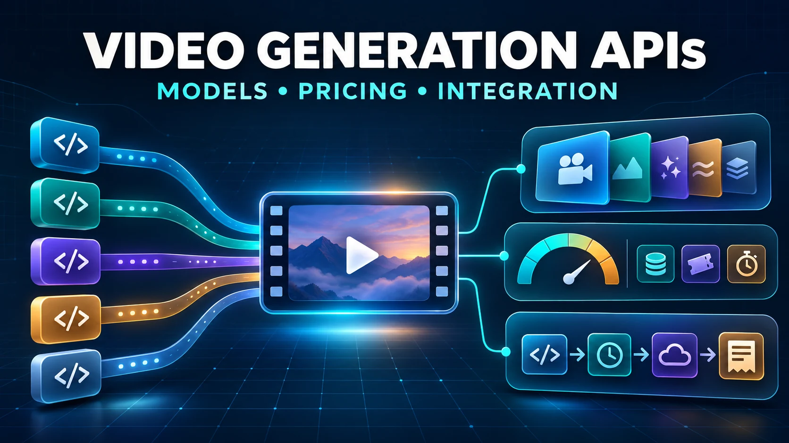
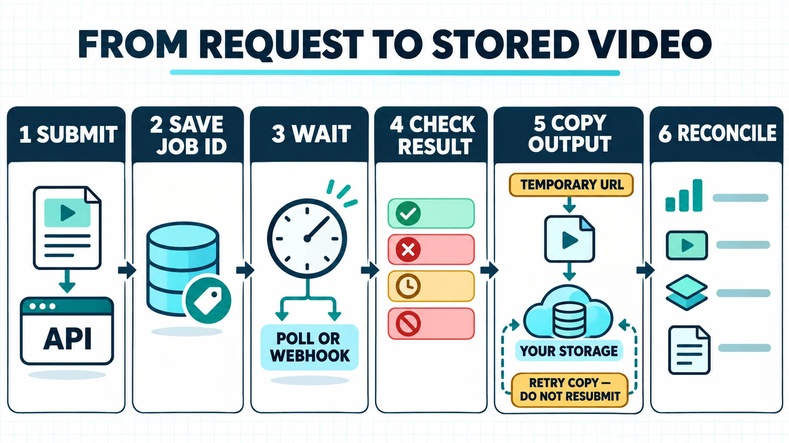

# Video Generation APIs Compared: AI Models, Pricing, and Integration Tradeoffs

*Compare the required model contract, billing unit, and integration work before selecting a video generation API.*

*A contract-first comparison of Google, Runway, Luma, fal, and Replicate for product teams choosing a video generation API.*

There is no price-only winner among video generation APIs. A $0.02-per-second model and a $0.10-per-second model may accept different inputs, produce different resolutions, include different audio behavior, or require different retry and storage work. A useful comparison starts with the exact job your product must complete.

For a first shortlist:

- **Start with Google** when Gemini Omni Flash fits the required output and a first-party Google route matters.
- **Start with Runway** when Runway models or its curated multi-model catalog fit, and credit-based accounting is acceptable.
- **Start with Luma** when Ray 3.2's generation, edit, reframe, or capacity options match the workload.
- **Start with fal** when broad model experimentation and explicit queue controls matter more than a single model-maker relationship.
- **Start with Replicate** when access to official and community models is useful and the team can evaluate the contract of each model separately.

None of those is a quality ranking. No clips, accounts, keys, invoices, or latency results were tested for this article. The deciding metric is the cost of an accepted clip that your application successfully stores.

## Define the video job before comparing providers

Write down the output before opening a pricing page. “Generate a video” is too vague to compare.

A text-to-video request begins with a prompt. Image-to-video adds a source image or first frame. Video-to-video, editing, extending, or reframing starts from an existing clip. These modes can use different models, request fields, duration rules, and prices even inside one provider.

The **model contract** is the exact combination that makes a request valid: model ID, input type, duration, resolution, aspect ratio, audio behavior, output format, and completion process. In plain language, it is the specification for what you send and what you get back. If a second route cannot reproduce that specification, it is not a substitute, however attractive its list price looks.

Create one workload card before comparing providers:

- input: text, image, source video, reference images, or a combination;
- output: duration, resolution, aspect ratio, frame rate, file type, and whether audio is required;
- controls: first or last frame, seed, camera instruction, edit mask, reframe, or extension;
- volume: requested clips on a normal day and during the busiest hour;
- acceptance: the percentage of outputs the product can actually use;
- operations: maximum wait time, cancellation needs, storage destination, and retention period;
- governance: moderation, regional, data-use, and account requirements that apply to the product.

This card is the common denominator. Without it, a provider table compares brand names rather than equivalent work.

## Five video-generation API routes compared

The table below describes representative routes, not every model in the market. “Verify first” is the field most likely to remove a route from the shortlist.

| Route | Model access | Published billing pattern | Job and output contract | Strong fit when | Verify first |
|---|---|---|---|---|---|
| Google Gemini API | Current Gemini video route | Input and output tokens; Google publishes a 720p video-token conversion | Long-running generation with a current Google model and API lifecycle | A Google-first route and Gemini Omni Flash contract fit | Exact model ID, output settings, paid-tier access, current lifecycle |
| Runway Dev | Runway models plus selected third-party models | Credits, often per output second; surcharges can apply | Task ID, status retrieval, temporary output URLs | The catalog and Runway task model fit the product | Model-specific input schema, credits, output format surcharge, retention |
| Luma Agents API | Ray 3.2 video operations | Credits per configuration or operation | Generation job retrieved by ID; shared or provisioned capacity | Ray controls and capacity choices match the workload | Credit-to-dollar value, request type, resolution, HDR, duration, capacity plan |
| fal | Multi-model generative-media platform | Model-specific seconds, tokens, images, or other units | Queue request ID, status/result/cancel URLs, optional webhook | The team wants broad model access and explicit queue primitives | Exact endpoint, settings, rate, result retention, storage options |
| Replicate | Official and community models | Exact model may bill by output, input, or compute | Prediction lifecycle with polling, streaming, or webhooks | The team wants a broad catalog and will distinguish model contract types | Official versus community status, versioning, schema, price, data retention |

Google's [current Gemini video guide](https://ai.google.dev/gemini-api/docs/video) directs Gemini API video work to Gemini Omni Flash and records that the Veo 3.1 Preview route shut down on October 22, 2026. That lifecycle change is a practical warning: choosing a provider does not freeze a model ID. A migration trigger belongs in the design from day one.

[Runway's current model catalog](https://docs.dev.runwayml.com/guides/models/) exposes different models and billing units behind one developer platform. That breadth can reduce vendor onboarding, but it does not make one model's request fields or output behavior portable to another.

Luma's [current video guide](https://docs.agents.lumalabs.ai/guides/videos/) centers on Ray 3.2 generation, editing, extending, and reframing. It is a model-maker route with controls and capacity choices that may be more important than catalog breadth.

fal makes the asynchronous contract visible: [fal's queue submission contract](https://fal.ai/docs/api-reference/inference-api/queue/submit) returns a request ID plus status, result, and cancellation URLs, and it can accept a webhook. Replicate needs an additional distinction. [Replicate's official-model contract](https://replicate.com/docs/topics/models/official-models) describes official models as always on, stable in their input/output API, actively maintained, and priced by predictable metrics. A community model can have a different versioning and compute-price contract.

The routes therefore differ at two levels: which model is reachable, and what operational promise surrounds that model. Compare both.

## Normalize pricing before ranking it

A **billable unit** is simply what the provider charges for. It may be a generated second, a token converted into video time, a credit, one configured generation, or compute time. Prices cannot be ranked until those units are translated into the same workload card.

These representative rates were published when checked on November 3, 2026. They are price examples, not equivalent model outputs or a value ranking.

| Route and exact example | Published unit | Five-second exposure before retries | What the number leaves out |
|---|---:|---:|---|
| Google Gemini Omni Flash, 720p video output | $17.50 per 1M output tokens; 5,792 tokens per video second | About $0.51, plus input | Acceptance rate, storage, taxes, account terms, other settings |
| Runway Gen-4.5 | 12 credits/second; credits purchasable at $0.01 each | $0.60 | Input/reference charges, format surcharges, retries, storage, tax |
| Luma Ray 3.2, standard 720p generation | 100 credits for 5 seconds | 100 credits | A credit's dollar value depends on the account plan or contract |
| fal H3 Max Turbo text-to-video | $0.015/second | $0.075 | Other models and settings can use very different rates |
| Replicate | No platform-wide video rate | Model-specific | Official/community status, billing metric, schema, hardware or output unit |

Google's calculation follows its [current pricing table](https://ai.google.dev/gemini-api/docs/pricing): 5,792 video tokens per second at $17.50 per million output tokens equals about $0.10136 per 720p output second. A five-second clip is therefore about $0.51 for video output, before input and other costs.

[Runway's current credit rates](https://docs.dev.runwayml.com/guides/pricing/) price a project credit at $0.01 and list Gen-4.5 at 12 credits per second. Five seconds is 60 credits, or $0.60, before any applicable input or professional-output charges.

Luma should stay in credits until the account supplies a conversion. [Luma's current pricing table](https://docs.agents.lumalabs.ai/guides/pricing) lists standard Ray 3.2 generation at 100 credits for five seconds and 300 credits for ten seconds at 720p. The same page says the dollar value of a credit depends on the account's plan or contract. It also distinguishes shared pay-as-you-go capacity, which has no latency SLA, from provisioned throughput. Treating 100 credits as a universal dollar amount would be false precision.

fal illustrates catalog spread. Its [model-by-model pricing page](https://fal.ai/pricing) listed H3 Max Turbo text-to-video at $0.015 per second and Kling Video v3 Pro text-to-video at $0.14 per second when checked. That gap is not proof that one is better value. They are different models, and settings can change the bill.

The monthly formula should include failed creative attempts:

> **Billable attempts = requested clips × (1 + regeneration rate)**  
> **Generation spend = billable attempts × rate for the exact model and configuration**

The **regeneration rate** is the share of clips that must be tried again because an output is not usable. For 1,000 requested five-second clips and a 25% regeneration rate, budget for 1,250 attempts. On the representative Google output rate, that is about $633.50 plus input and other costs. On Runway Gen-4.5, it is $750 before other charges. On fal's H3 Max Turbo example, it is $93.75. Luma would be 125,000 credits, which cannot be converted honestly without the account rate. These figures measure exposure for unlike products; they do not identify a winner.

Add storage, egress, moderation, post-processing, taxes, discounts, minimum commitments, and provisioned capacity where they apply. Then divide total spend by accepted, stored clips—not by submitted requests.

## Integration tradeoffs you will own

Most video generation is an **asynchronous job**. In plain language, the API accepts work now and returns an ID while the video finishes later. The consequence is important: a successful submission is not a successful video, so the product needs a job system rather than one request handler.

<picture>
  <source media="(max-width: 600px)" srcset="assets/async-video-generation-job-lifecycle-narrow.webp">
  
</picture>

*Treat video generation as an asynchronous job: store the request ID, wait for completion, copy temporary outputs, then reconcile accepted clips and charges.*

A minimal flow is:

1. **Submit** the exact model and configuration with an internal idempotency key.
2. **Store** the provider, model ID, request ID, settings, and quoted billing unit.
3. **Wait** by polling within the provider's guidance or receiving a verified webhook.
4. **Classify** success, failure, timeout, cancellation, and retry without creating accidental duplicate jobs.
5. **Retrieve and persist** the finished file in application-controlled storage.
6. **Reconcile** attempts, accepted outputs, provider usage fields, and the invoice.

Polling is easier to start with, but every poll adds traffic and needs backoff. Webhooks reduce polling, but the receiver must verify the sender, tolerate duplicate delivery, and fetch final state when events arrive out of order. Cancellation does not automatically mean “not billed”; verify the endpoint's rule before promising it in a product.

**Output retention** means how long the provider keeps the result available. A result URL is not necessarily permanent storage. According to [Runway's output-retention guidance](https://docs.dev.runwayml.com/guides/outputs/), its result URLs expire within 24–48 hours and should be downloaded into your own storage rather than exposed directly in a product. [fal's completed-result retention rules](https://fal.ai/docs/api-reference/inference-api/queue/result) say a result is kept for one hour, or six minutes when it is at least 10 KB, unless payload storage extends that period. [Replicate's prediction retention policy](https://replicate.com/docs/topics/predictions/data-retention) removes API-created prediction inputs, outputs, files, and logs after one hour by default.

Those windows make persistence part of the critical path. Save the provider result, content type, checksum, destination URL, and time copied. If persistence fails, retry the copy without resubmitting the generation.

Switching cost is the code, evaluation, data, and operational work needed to move to another provider or model. Reduce it with a small internal job record—provider, model, configuration, external ID, state, cost fields, output location, and raw response—but do not force every provider into a fictional universal schema. Preserve provider-specific fields so advanced controls and billing evidence are not lost.

## Choose by workload, not provider popularity

Use the workload card and disqualifiers, then run the same acceptance test on the remaining routes.

- **Choose Google first** when Gemini Omni Flash's current inputs and outputs fit, a Google developer route is useful, and token-based reconciliation is acceptable. Do not choose it on brand familiarity if the required model contract or lifecycle does not fit.
- **Choose Runway first** when its current catalog contains the needed model and the task, credit, and temporary-output workflow fits your product. Do not treat one Runway integration as proof that every routed model has identical controls.
- **Choose Luma first** when Ray 3.2's generation or edit controls match and the team can choose deliberately between shared pay-as-you-go capacity and provisioned throughput. Do not convert credits using a guessed dollar value.
- **Choose fal first** when rapid model comparison and queue primitives are central to the proof of concept. Do not assume a platform-wide price or retention rule; confirm the exact endpoint.
- **Choose Replicate first** when official and community model breadth is valuable and the team can evaluate each model's lifecycle. Do not apply the official-model stability promise to every community model.

Output quality still matters, but it must be tested with the same inputs and acceptance rubric. A useful test records why each clip is accepted or rejected—prompt adherence, identity consistency, motion, artifacts, audio, duration, and required format—rather than relying on a favorite demo. This research did not perform that test.

## Where a unified API route can help

A unified route can reduce the number of provider-facing adapters a team maintains. That can make model discovery, credential handling, and route changes easier. It does not make models interchangeable: model IDs, accepted fields, output handling, limits, prices, and lifecycle rules can still differ.

Moduck's confirmed product areas include model discovery and selection, pricing information, and API access through a unified AI API platform. The available evidence does not confirm that any model named in this comparison is currently available through Moduck, that the schema matches a first-party route, or that a particular account can call it.

If a unified route remains on your shortlist, compare the [current Moduck documentation](https://docs.moduck.ai/) with the exact model contract your workload requires.

Verify the model ID, input and output schema, price, limits, account terms, lifecycle, and current availability before implementation.

Apply the same proof-of-concept acceptance test, persistence checks, and cost reconciliation to a unified route that you apply to a first-party route. If the required contract cannot be verified, keep the verified first-party or model-specific route in the lead.

## Build a decision packet before production

For each shortlisted route, save one compact decision packet:

- provider, endpoint, exact model ID, and version or lifecycle status;
- request mode, reference assets, duration, resolution, audio, and output settings;
- published rate, billing unit, account conversion or discount, and check date;
- requested jobs, billable attempts, successes, accepted clips, and rejection reasons;
- submission-to-completion time distribution, timeouts, errors, retries, and cancellations;
- output-retention window, storage completion, egress, and post-processing cost;
- moderation, data-use, region, capacity, and account conditions;
- migration trigger and the fields that a replacement route must reproduce.

Select only among routes that pass the required model contract. From those, compare total cost per accepted, stored clip and the operational work needed to keep requests traceable from submission to invoice. A lower list rate is worth choosing only when its acceptance rate, lifecycle, storage path, and support requirements still produce the better total.

Re-run the comparison when a model ID, provider route, request schema, price, capacity plan, result-retention rule, or workload mix changes. That is how the decision stays auditable instead of becoming a spreadsheet that looks current after its assumptions have expired.

*Research scope: four general English-language search queries and selected first-party documentation were sampled on November 3, 2026 without country, device, account, or personalized-result localization. Prices and policies can change. No account, API key, model request, generated output, quality result, latency result, invoice, payment, eligibility, or production availability was tested.*
